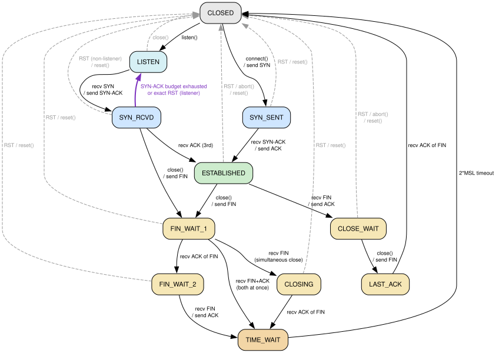

# tcp-sans-io

A `#![no_std]`, zero-allocation, sans-I/O TCP stack in Rust. Designed to live
**in front of an external WireGuard backend** and **behind a foreign-language
async runtime** (C# / Python / Go) via a stable C ABI.

```
┌───────────────────────────┐    ┌───────────────┐    ┌───────────────────┐
│  Host runtime (C# / Py /  │ ↔  │ tcp-sans-io   │ ↔  │  WireGuard tunnel │
│  Go / native), via C ABI  │    │ (Rust cdylib) │    │  (host-supplied)  │
└───────────────────────────┘    └───────────────┘    └───────────────────┘
                                 sans-I/O:
                                 - no syscalls
                                 - no allocations
                                 - no threads
                                 - no panics
```

The stack itself does no I/O. The host:
1. Hands bytes from the WireGuard side into `tcp_inject_packet(..)`.
2. Drains outbound bytes via `tcp_extract_packet(..)`.
3. Calls `tcp_tick(now_ms)` when `tcp_next_deadline(..)` comes due (and
   after `tcp_send`) to drive timers and transmission.
4. Reads/writes application data via `tcp_recv(..)` / `tcp_send(..)`.

## Features (RFC matrix)

The loss-recovery and hardening feature set of a modern Linux TCP, minus
CUBIC/BBR: RACK-TLP is the primary loss detector, PRR paces recovery, SACK
and D-SACK work in both directions, timestamps carry RTT samples and PAWS,
and the RFC 5961 / Linux-style defences and lifecycle timers are on by
default. Congestion control is Reno (RFC 5681 + RFC 6937); *Benchmarks*
shows what that costs against Linux CUBIC on lossy long paths.

| Feature | Spec | Status |
|---|---|---|
| State machine, active + passive open, simultaneous open | RFC 9293 | ✅ |
| Half-open replacement (a new SYN recycles a stalled `SYN_RCVD` slot) | — (single-slot listener policy) | ✅ |
| SYN cookies while the half-open slot is busy (a valid cookie ACK takes the slot over); WS / SACK / ECN kept via timestamp bits; key derived from the host secret or set explicitly, surviving one rotation | RFC 4987 | ✅ |
| ISN selection | RFC 6528 | ✅ keyed by `tcp_set_secret` on passive opens (`tcp_listen` requires a secret); host-supplied `iss` on active |
| MSS; MTU / PMTU (`tcp_set_mtu`, `tcp_update_pmtu`, black-hole clamp, probing back up) | RFC 9293, RFC 1191, RFC 4821 (spirit) | ✅ |
| Timestamps: RTTM, PAWS, keyed per-connection offset | RFC 7323 §3–5 | ✅ |
| Window Scale | RFC 7323 §2 | ✅ |
| SACK, both directions; receiver holds the whole window out of order | RFC 2018 | ✅ |
| D-SACK, both directions (drives RACK's reordering window) | RFC 2883, RFC 3708 | ✅ |
| RTO with Karn's algorithm | RFC 6298 | ✅ |
| Slow start / congestion avoidance (byte counting, cwnd-limited growth) | RFC 5681, RFC 3465, RFC 7661 (spirit) | ✅ |
| Proportional Rate Reduction | RFC 6937 | ✅ |
| Initial window of 10 segments | RFC 6928 | ✅ |
| RACK-TLP: time-based loss detection, tail loss probe | RFC 8985 | ✅ primary loss detection |
| Duplicate-ACK fast retransmit (peers without SACK) | RFC 5681 §3.2 | ✅ fallback |
| ECN (ECT(0) on new data; ECE → one CWR reduction per window) | RFC 3168 | ✅ |
| Blind-attack hardening: RST, SYN and ACK checks, rate-limited challenge ACKs | RFC 5961 §3–5, §7 | ✅ |
| Silly-window avoidance, sender and receiver | RFC 9293 §3.8.6.2 | ✅ |
| Window-update rule (SND.WL1 / WL2) | RFC 9293 §3.10.7.4 | ✅ a forged future WL1 cannot freeze it |
| Zero-window persist probes | RFC 9293 §3.8.6.1 | ✅ Linux-style probe at `SND.UNA − 1` |
| Delayed ACK (2nd full segment / 40 ms; immediate for out-of-order and duplicates) | RFC 1122 §4.2.3.2, RFC 5681 §4.2 | ✅ |
| R2 retransmission limit, USER TIMEOUT, keepalive | RFC 9293 §3.8.3–3.8.4 | ✅ on by default |
| FIN_WAIT_2 timeout | Linux `tcp_fin_timeout` | ✅ 60 s, restarted only by the application reading |
| TIME_WAIT, re-ACK and restart on a retransmitted FIN | RFC 9293 §3.10.7.4 | ✅ 60 s; restarts capped at 120 s after entry |

### Deliberately deferred

| Feature | Spec | Why deferred |
|---|---|---|
| CUBIC (+ HyStart) | RFC 9438 | The main remaining gap: on lossy long paths Linux CUBIC sustains a multiple of Reno's goodput (see *Benchmarks*). Planned as a selectable algorithm. |
| BBR | — | Model-based congestion control; a different architecture. |
| Pacing | — | Bursts are bounded by cwnd and PRR instead. |
| TCP Fast Open | RFC 7413 | Data-in-SYN has a complex security model. |
| MPTCP | RFC 8684 | A different connection model. |

### Deliberately omitted (out of scope)

- IPv6 (the WireGuard backend is the v6-aware layer; we present IPv4 to the
  tunnel).
- Listening on multiple connections per TCB (one connection per TCB — the
  host multiplexes).
- Out-of-band data (`URG`).
- TCP-MD5 / TCP-AO authentication.

## Design constraints

- `#![no_std]`, no heap allocation, no panics, no threads, no syscalls.
- Hot paths use fixed-size ring buffers and are zero-allocation.
- `unwrap`, `expect`, `panic!`, `indexing_slicing` are deny-listed via Clippy
  (see `Cargo.toml`).
- All packet parsing is bounds-checked and returns `Result`; never panics on
  arbitrary input.
- C ABI version is stable (queryable via `tcp_abi_version()`); bump it on
  any breaking change.

### Memory footprint

Per connection, `tcp_handle_size()` is **2,176,864 bytes (≈ 2.08 MiB)** with
default features, or **139,488 bytes (136 KiB)** with `small-buffers`:

- `BUF_CAP` send ring + receive ring (2 × 1 MiB; 2 × 32 KiB with
  `small-buffers`). Out-of-order data is parked inside the receive ring at
  its final offset, so the whole advertised window can be held while a hole
  is repaired at no extra memory cost.
- 48 KiB egress staging ring (32 × `MAX_PACKET`).
- 24 KiB retransmission queue (1024 segment records, plus a 128-byte
  bitmap of the SACKed ones).
- 6 KiB out-of-order range tracker (512 ranges; 384 B / 32 ranges with
  `small-buffers`).
- Under 1 KiB of scalar state.

The 1 MiB default lets the receive window fill typical WAN paths (1 MiB per
RTT ≈ 168 Mbit/s at 50 ms); raise `BUF_CAP` (a power of two) for fatter
pipes or use `small-buffers` for many mostly-idle connections.

`tcp_init` / `Tcb::init_in_place` build the TCB directly in its storage and
need under 32 KiB of the calling thread's stack. `Tcb::new` returns the
whole TCB by value, so pure-Rust callers should box it (or use
`init_in_place`); the repository's `.cargo/config.toml` raises
`RUST_MIN_STACK` for tests that keep TCBs on the stack.

## Connection state machine

The eleven TCP states and every transition the stack can take. The graph is
**implementation-accurate** — its edges are exactly the relation of
`State::debug_transition_allowed()` (`src/state.rs`). Every fuzz target panics
if the live TCB makes a move outside it, and a unit test fails if
`docs/state-machine.dot` draws a different set of edges, so the picture and
the code cannot drift apart.



Bold purple is the non-textbook **SYN_RCVD → LISTEN** revert: a listener
keeps at most one half-open slot and recycles it after a bounded SYN-ACK
retransmit budget (or an exact RST), rather than leaking it. Green edges are
SYN-cookie promotions: while the slot is busy, other peers get cookie
SYN-ACKs, and a valid cookie ACK establishes directly — from SYN_RCVD by
taking the slot over. Dashed grey edges are aborts (RST / `abort()` /
timeouts). See
[`docs/state-machine.md`](docs/state-machine.md) for a live-rendering Mermaid
copy, the full transition table with code citations, and how to regenerate the
SVG from [`docs/state-machine.dot`](docs/state-machine.dot).

## Extents and bounds

Every data structure in the stack is fixed-capacity — there is no
allocator and nothing grows with peer behaviour. The table lists each
bound, where it lives, and what it caps. **The central invariant is that
every one of these is a *performance* knob, not a *correctness* knob**
(see "Why the bounds are sound" below): exceeding a capacity always
degrades to retransmission or backpressure, never to data loss,
mis-ordering, corruption, a panic, or an unbounded loop.

| Bound | Value | Where | What it limits |
|---|---|---|---|
| `BUF_CAP` | 1 MiB (32 KiB w/ `small-buffers`) | `lib.rs` | Send + receive ring capacity: the receive window, out-of-order storage and the in-flight ceiling per RTT. Power of two; the window-scale shift derives from it (5 at 1 MiB). |
| `MSS` / `MAX_PACKET` | 1460 / 1500 B | `lib.rs` | Largest payload / datagram. `tcp_set_mtu` lowers both (576–1500). |
| `OOO_MAX_RANGES` | 512 (32 w/ `small-buffers`) | `ooo.rs` | Disjoint out-of-order ranges held in the receive ring: one per two full segments of buffer, enough for a full window with every other segment lost. |
| `RTX_QUEUE_CAP` | 1024 | `rtx_queue.rs` | Segments in flight. When full, new data waits for ACKs; nothing is evicted, so every in-flight segment keeps SACK/RACK coverage. |
| `TX_RING_CAP` | 32 | `tx_ring.rs` | Egress packets staged before the host must drain. |
| SACK blocks emitted | ≤ 4 (≤ 3 with timestamps) | `tcb/output.rs` | Bounded by the 40-byte option area; dropped from full-sized data segments rather than shrinking the payload. |
| `INITIAL_WINDOW` | 10 × SMSS (14,480 B with timestamps) | `congestion.rs` | RFC 6928 initial cwnd. |
| `MIN_PEER_MSS` | 64 B | `tcb/mod.rs` | Floor on a peer-requested MSS (bounds per-byte header and queue cost). |
| `RTO_MIN` / `RTO_MAX` | 200 ms / 60 s | `tcb/mod.rs` | RTO clamp; exponential backoff is capped at `RTO_MAX`. |
| TLP PTO floor / delayed ACK / `TIME_WAIT` | 10 ms / 40 ms / 60 s (≤ 120 s) | `tcb/mod.rs` | Probe timeout floor, delayed-ACK timer, 2·MSL; a retransmitted FIN restarts 2·MSL, at most 120 s after entry. |
| `MAX_SYN_RETRIES` / `MAX_SYN_RCVD_RETRIES` | 6 / 5 | `tcb/mod.rs` | SYN retransmissions before an active open fails; SYN-ACK retransmissions before a half-open reverts to `LISTEN`. |
| `MAX_RETRANSMITS` | 10 | `tcb/mod.rs` | RFC 9293 §3.8.3 "R2": consecutive timeouts (data, FIN or unanswered zero-window probes) with no proof of life before abort. |
| USER TIMEOUT | 300 s | `tcb/mod.rs` | Max time with outstanding send work but less than one full segment acknowledged; reaps stalled, zero-window and sub-MSS-trickle peers. A reader acknowledging a full segment per period is live progress, not a stall (see *Threat model*). `set_user_timeout(0)` disables. |
| Keepalive | 600 s idle / 60 s / 4 probes | `tcb/mod.rs` | Reaps a vanished peer on an idle connection. `set_keepalive(0, …)` disables. |
| FIN_WAIT_2 timeout | 60 s | `tcb/mod.rs` | Time a peer may leave its half open after ACKing our FIN; restarted only when the application reads, never by the peer's data alone. |
| Black-hole MSS clamp / probe | 3, 5 RTOs → 1024, 536 / 10 s … 10 min | `tcb/mod.rs` | Consecutive timeouts of a large segment clamp the MSS; one probe segment at the next larger size (first after 10 s, doubling up to 10 min on failure) restores it once it arrives. |
| Out-of-window reply rate | 1 per 500 ms | `tcb/mod.rs` | Challenge ACKs, dup ACKs for unacceptable segments and RSTs to stray segments, per connection. Exempt: one immediate ACK (D-SACK) per data / FIN segment that could be the peer's own retransmission — acceptable ACK, plus a timestamp when negotiated — since the peer's loss recovery depends on it. |
| Cookie validity | 64–128 s | `tcb/cookie.rs` | Two 64 s buckets, under the current and the previous key (one rotation); 29-bit SipHash MAC (2⁻²⁹ blind forgery per attempt). |

### Why the bounds are sound

The receiver only ever delivers a **contiguous prefix** starting at
`rcv_nxt`, and only ever cumulatively ACKs / SACKs data it is actually
holding. So any byte the stack cannot store is simply never acknowledged,
and the peer retransmits it. Concretely:

- **Out-of-order tracker full** (a 513th disjoint range) → the segment is
  dropped, never SACKed, and resent by the peer. Nothing already SACKed is
  ever discarded (no reneging). The application can never observe a gap.
- **Retransmission queue full** → no new segment is sent until an ACK frees
  a record; recovery state is never lost.
- **`TX_RING_CAP` full** → emit returns "ring full" and bookkeeping
  (`snd_nxt`, FIN state) is not advanced, so nothing is skipped; the host
  drains and ticks again.
- **Receive ring full** (application not reading) → the advertised window
  shrinks to zero, the peer stalls on flow control, and persist probes keep
  the connection alive until the USER TIMEOUT applies.

Shrinking `BUF_CAP` changes throughput, never the bytes the application
sees.

### Out-of-order capacity

Out-of-order bytes are written straight into the receive ring at their
final offset, so the receiver holds everything inside its advertised window
while holes are repaired, as Linux does. Only the number of disjoint ranges
is bounded. 512 covers the worst realistic pattern: a slow-start overshoot
into a tail-drop queue that loses every other segment of a full window. (A
32-range tracker could not; the link simulation in `src/sim_tests.rs`
caught it forcing 66 avoidable retransmissions in a single overshoot.) An arriving
segment costs a binary search, plus an O(ranges) shift of 12-byte records
when a hole closes.

### Termination and resource safety

These bounds also make the stack **DoS-resistant and hang-free** against a
hostile peer:

- **No unbounded loops.** Every loop reachable from `inject_packet` /
  `tick` / `send` is bounded by a fixed-capacity structure, a
  strictly-advancing index, or (for the transmit loop) an explicit
  `loop_budget_exhausted` guard that panics under test/fuzz builds and
  stops gracefully in the shipped build.
- **No busy timers.** After `tick()` at `now`, `tcp_next_deadline()` is
  always later than `now`, so an event-driven host never spins (checked by
  the link simulation on every step).
- **No amplification.** One inbound segment stages at most `TX_RING_CAP`
  packets, and replies to unacceptable segments are rate-limited per
  connection; only a data or FIN segment carrying an acceptable ACK (and a
  timestamp when negotiated) is answered at once, with a single ACK.
- **No state exhaustion inside a TCB.** One half-open per listener TCB
  with a bounded SYN-ACK budget, and stateless SYN cookies for every other
  peer while it is busy; no allocator to drain. (Bounding the *number* of
  TCBs is the host's job.)
- **No information disclosure.** Emitted packets are built in
  zero-initialised scratch with exactly the payload bytes copied;
  `tcp_init` zeroes reused storage; timestamps are offset per connection
  by a keyed hash (with `tcp_set_secret`) so they reveal neither the host
  clock nor a cross-connection correlator.

## Clock model and tick cadence

TCP is **inherently time-dependent**: retransmission (RTO), Tail Loss
Probe (TLP), delayed-ACK, `TIME_WAIT`, zero-window persist probing, and
RACK's reordering window are all driven by elapsed time, not by packets
alone. This stack handles that without owning a clock, threads, or
syscalls: **`now_ms` (`u64` milliseconds) is supplied by the host** on
every `tcp_tick`, `tcp_inject_packet`, `tcp_connect` / `tcp_listen`,
`tcp_close` and `tcp_abort` call. The stack has no other notion of time.

That is the core reason the library is shaped this way. A sans-I/O stack
with an **external clock source** is a pure, deterministic function of
`(inputs, now_ms)` — which is exactly what makes it testable: the
conformance suite steps the clock millisecond-by-millisecond, and the
gVisor chaos harness advances a virtual clock by hand to reproduce loss
and reordering byte-for-byte. The same code path runs in production
against a real monotonic clock. There is no hidden timer thread to mock.

**What drives output.** Responses to inbound packets (ACKs,
retransmissions, newly permitted data) are staged *inline* during
`inject`; `close` stages the FIN and `recv` may stage a window update.
`send` only buffers: the next `tick` (or inbound ACK) turns the bytes into
segments. Timer *expiry* (RTO, TLP, RACK reorder timer, persist,
keepalive, delayed ACK, FIN_WAIT_2, `TIME_WAIT`, USER TIMEOUT) is evaluated
only inside `tick()`.

**When to tick.** `tcp_next_deadline()` (`Tcb::next_deadline`) returns the
absolute `now_ms` at which `tick()` next has timer work, or `UINT64_MAX`
when nothing is armed. An event-driven host sleeps until the earlier of
that deadline and the next datagram, then ticks — idle connections cost
nothing, and after a tick the deadline is always in the future (no
spinning). Also tick right after `send`, after draining a full egress
ring, and after resuming paused egress (`Tcb::set_egress_paused`). Hosts
that cannot track deadlines tick every ~10 ms instead.

**How fast does the clock need to drive?** The timer floors are:

| Timer | Floor | Effect of a coarse/late tick |
|---|---|---|
| RACK reorder window | `min_RTT/4` (× D-SACK multiplier, ≤ SRTT) | Loss declared slightly later on low-RTT reordering paths. |
| TLP PTO | `max(2·SRTT, 10 ms)` | Tail-loss probe fires up to one tick late. |
| Delayed ACK | 40 ms | ACK latency rises by up to one tick. |
| RTO | `200 ms … 60 s` | Negligible: a 10 ms tick is 20× finer than the floor. |
| `TIME_WAIT` | 60 s | Irrelevant to cadence. |

Without deadline tracking, a **~10 ms periodic tick with 1–2 ms of jitter
is adequate** — it matches the TLP floor and is far finer than `RTO_MIN`.
Finer only helps RACK on very-low-RTT LAN paths where `min_RTT/4` dips
below 10 ms. **Cadence and jitter affect only loss-recovery
latency and ACK timing — never correctness** (per the bounds invariant
above): a coarse or jittery clock makes recovery slower, never wrong.

**Clock requirements.**

- Use a **monotonic, millisecond-resolution** source — `Instant`,
  `clock_gettime(CLOCK_MONOTONIC)`, `QueryPerformanceCounter` — not
  wall-clock. A backward step just postpones timers and a large forward
  jump fires them early; both are harmless but best avoided.
- The recommended driving pattern is **event-driven**: tick with a fresh
  `now_ms` after a batch of injects and sends, and sleep until
  `tcp_next_deadline()` otherwise. Pass the *same* `now_ms` you read for
  that turn into every call in the turn.

## How does it perform?

Measured against Linux on the same emulated paths (next section), as a
sender and as a receiver:

| Path | Result |
|---|---|
| Clean LAN / WAN | Line rate, indistinguishable from Linux. |
| Random loss (0.1–5 %) | Reno-class, as the Mathis model predicts: at or above Linux Reno; at these RTTs Linux CUBIC is in its Reno-friendly region and does no better. |
| Shallow bottleneck buffers | Slightly above Linux Reno, about 10 % below Linux CUBIC. |
| Slow-start exit | Overshoots like Linux Reno (no HyStart): a queue's worth of drops, repaired by SACK + RACK without a timeout. CUBIC's HyStart avoids most of them. |
| Reordering | Learned via D-SACK; spurious reductions are undone. |
| As a receiver | Linux CUBIC reaches the same goodput sending to tcp-sans-io as to Linux. |
| Long fat pipes | Capped by `BUF_CAP` (1 MiB per RTT ≈ 168 Mbit/s at 50 ms) and Reno's linear growth; CUBIC would help here. |

In every measured cell each retransmission repaired a real drop and no RTO
fired.

## Benchmarks

### Method

`bindings/netem/bench.sh` compares tcp-sans-io with Linux TCP on the
**same path**. Every run builds three network namespaces from scratch: a
sender (tcp-sans-io behind a TUN device, IP-forwarded, or a Linux socket),
a router, and a receiver whose Linux socket measures goodput the same way
for every stack. The router shapes both directions: data gets netem delay
(RTT/2), random loss and a rate-limited bottleneck with a tail-drop queue;
ACKs get the other RTT/2. Each run records goodput (connection established
→ last byte), the sender's retransmitted segments (`tcp_get_stats` /
`TCP_INFO`), the router's drops and the receiver's duplicates (D-SACKs).
Five runs per cell; medians with min–max.

The harness avoids four traps that each distorted an earlier set of
numbers (including this README's previous table):

1. **Shaping the TUN's root qdisc shapes only kernel egress** — for an
   upload that is the ACK path, so "1 % loss" runs had a lossless data
   path (the old 157 MiB/s at 1 % loss).
2. **Linux TCP builds GSO super-packets even with `ethtool -K … gso off`**
   and segments them after the qdisc, so netem drops multi-segment bursts
   as one packet. `gso_max_segs 1` on every veth makes all stacks' packets
   alike.
3. **A qdisc on the sender's own interface reports tail drops to local TCP
   synchronously**, which resends without counting a loss — flattering
   Linux senders. The bottleneck therefore sits on a router.
4. **TUN writes from a thread that migrates between CPUs** land on
   different CPUs' backlogs and can be forwarded out of order — reordering
   no Linux sender sees. The sending endpoint is pinned to one CPU.

Host: AMD Ryzen 9 9950X, Linux 7.3, Ubuntu 26.04. tcp-sans-io uses its
default 1 MiB buffers; Linux uses the host's `tcp_rmem` / `tcp_wmem`.

| Profile | RTT | Bottleneck | Loss | Queue | Transfer |
|---|---|---|---|---|---|
| lan | 1 ms | 1 Gbit/s | 0 | 200 pkts | 512 MiB |
| wan | 40 ms | 100 Mbit/s | 0 | 160 pkts | 128 MiB |
| wan-0.1 | 40 ms | 100 Mbit/s | 0.1 % | 160 pkts | 32 MiB |
| wan-1 | 40 ms | 100 Mbit/s | 1 % | 160 pkts | 8 MiB |
| metro-0.1 | 10 ms | 200 Mbit/s | 0.1 % | 80 pkts | 64 MiB |
| lossy-5 | 20 ms | 50 Mbit/s | 5 % | 80 pkts | 4 MiB |
| shallow | 20 ms | 100 Mbit/s | 0 | 16 pkts | 128 MiB |

### Results

Upload — the compared stack sends to a Linux receiver. Goodput in MiB/s,
median (min–max) of 5 runs; retransmitted segments / router drops, medians.

| Profile | tcp-sans-io | Linux Reno | Linux CUBIC | Retransmits / drops: tcp-sans-io · Reno · CUBIC |
|---|---|---|---|---|
| lan | 113.78 (113.71–113.86) | 113.82 (113.82–113.83) | 113.82 (113.82–113.83) | 230 / 230 · 193 / 193 · 41 / 41 |
| wan | 10.80 (10.80–10.80) | 10.77 (10.77–10.77) | 11.22 (11.21–11.23) | 236 / 236 · 449 / 449 · 20 / 20 |
| wan-0.1 | 1.62 (1.28–2.08) | 1.57 (1.46–2.69) | 1.66 (1.09–2.14) | 197 / 197 · 23 / 23 · 37 / 37 |
| wan-1 | 0.50 (0.45–0.61) | 0.41 (0.36–0.55) | 0.44 (0.40–0.59) | 56 / 57 · 58 / 58 · 55 / 55 |
| metro-0.1 | 5.95 (5.54–6.91) | 5.63 (4.95–6.07) | 5.06 (5.05–5.69) | 278 / 278 · 270 / 270 · 69 / 69 |
| lossy-5 | 0.41 (0.41–0.45) | 0.32 (0.30–0.33) | 0.25 (0.23–0.29) | 152 / 152 · 150 / 150 · 145 / 145 |
| shallow | 9.26 (9.26–9.73) | 9.13 (9.13–9.13) | 10.24 (10.24–10.24) | 160 / 160 · 155 / 155 · 145 / 145 |

Download — Linux CUBIC sends; the compared stack receives (5 runs for
tcp-sans-io; 10 for Linux, 15 on `lan`).

| Profile | tcp-sans-io receiver | Linux receiver | Sender retransmits / drops: to tcp-sans-io · to Linux |
|---|---|---|---|
| lan | 113.79 (113.78–113.80) | 113.79 (113.79–113.80) | 44 / 43 · 43 / 41 |
| wan | 11.17 (11.17–11.17) | 11.19 (11.19–11.19) | 26 / 26 · 20 / 20 |
| wan-0.1 | 1.80 (1.73–1.91) | 1.85 (1.44–2.84) | 46 / 46 · 37 / 37 |
| wan-1 | 0.41 (0.38–0.50) | 0.43 (0.35–0.53) | 58 / 58 · 58 / 58 |
| metro-0.1 | 5.57 (4.95–5.72) | 5.33 (4.50–6.30) | 62 / 62 · 60 / 60 |
| lossy-5 | 0.24 (0.24–0.25) | 0.26 (0.21–0.30) | 159 / 157 · 146 / 146 |
| shallow | 10.25 (10.25–10.25) | 10.23 (10.19–10.36) | 158 / 158 · 145 / 145 |

CPU: the tcp-sans-io endpoint process (stack, cgo, Go runtime and one TUN read/write syscall per packet) used 1.95 CPU-seconds per GiB sent at 1 Gbit/s.

Reading the numbers:

- **Clean paths**: line rate, the same as Linux.
- **Random loss**: Reno-class goodput, at or above Linux Reno. At these
  RTTs Linux CUBIC runs in its Reno-friendly region and is no faster; the
  0.1 % profiles vary most because the first random loss decides when slow
  start ends.
- **Efficiency**: tcp-sans-io's retransmissions match router drops in
  every cell, and no stack needed an RTO. The extra retransmissions in the
  `lan` and `lossy-5` download rows are Linux's; on `lan`, packet captures
  show it reacting to our ACKs being reordered on the harness's TUN path
  (their IP IDs arrive out of order). The same effect on data packets is
  why `bench.sh` pins the sending endpoint to one CPU.
- **Slow-start overshoot**: like Linux Reno, tcp-sans-io (no HyStart)
  overflows the queue once at the end of slow start (`wan`: 236 drops; Reno
  449) and repairs it without a timeout; CUBIC's HyStart exits early
  (20 drops).
- **As a receiver**, tcp-sans-io lets Linux CUBIC reach the same goodput as
  a Linux receiver does.

### Before and after the hardening

The same harness driving the pre-hardening library (commit `7dfe00b`),
upload direction (3 runs; 1 run for `wan` and `shallow`, where the old
stack needs minutes):

| Profile | Before: goodput MiB/s | Before: router drops / receiver duplicates | After: goodput MiB/s | After: router drops / receiver duplicates |
|---|---|---|---|---|
| wan | 1.00 | 14314 / 27354 | 10.80 (10.80–10.80) | 236 / 0 |
| wan-0.1 | 1.21 (1.15–1.22) | 449 / 4961 | 1.62 (1.28–2.08) | 197 / 0 |
| wan-1 | 0.33 (0.33–0.41) | 146 / 1251 | 0.50 (0.45–0.61) | 57 / 0 |
| lossy-5 | 0.23 (0.21–0.24) | 312 / 781 | 0.41 (0.41–0.45) | 152 / 0 |
| shallow | 0.67 | 9671 / 24215 | 9.26 (9.26–9.73) | 160 / 0 |

The old stack retransmitted data the receiver already held (tens of
thousands of duplicates) until its own retransmissions overflowed the
queue; a single slow-start overshoot was enough to collapse a clean path.

### Deterministic link simulation

`src/sim_tests.rs` runs two TCBs against each other over a seeded
discrete-event link and asserts efficiency, not just completion
(`cargo test --release --lib sim_tests -- --nocapture` prints one line per
scenario):

| Scenario | Goodput | Retransmits / drops | RTOs | TLPs | Duplicates at receiver |
|---|---|---|---|---|---|
| 50 Mbit/s, 20 ms, 64-packet queue (slow-start overshoot) | 5.73 MB/s (95 % of line rate) | 129 / 129 | 0 | 0 | 0 |
| 1 % random loss, 20 ms | 0.97 MB/s (1.09 × Mathis) | 34 / 34 | 0 | 0 | 0 |
| 1 % random loss, 50 ms | 0.35 MB/s (0.99 × Mathis) | 34 / 34 | 0 | 0 | 0 |
| 0.1 % random loss, 20 ms | 9.43 MB/s | 1 / 1 | 0 | 0 | 0 |
| 40 consecutive packets lost in one window | 9.62 MB/s | 40 / 40 | 0 | 0 | 0 |
| Last 3 of 10 segments lost | repaired in 150 ms | 3 / 3 | 0 | 1 | 0 |
| 2 % reordering (+4 ms), no loss | 5.69 MB/s (94 % of line rate) | 1 / 0 | 0 | 0 | 1 (learned via D-SACK, reduction undone) |
| 20 % ACK loss | 5.56 MB/s | 0 / 0 | 0 | 0 | 0 |
| Both directions, 1 % loss each way | 1.15 MB/s | 9 / 9 | 0 | 0 | 0 |
| Slow reader (500 KB/s) | 0.50 MB/s | 0 / 0 | 0 | 0 | 0 |
| 6 chaos seeds: 2 % loss + 3 % reordering both ways, sequence wrap | 1.5–3.3 MB/s | 102 / 88 | 0 | 0 | 8 (reordering) |

### Reproducing

```sh
sudo -v                                   # the script re-execs under sudo
bindings/netem/bench.sh                   # all profiles, 5 runs, both directions
bindings/netem/bench.sh --profiles "wan-1 shallow" --runs 3 --dir up \
    --stacks "tcp-sans-io reno cubic"
bindings/netem/bench.sh --profiles wan-1 --baseline-lib /path/to/old/target/release
```

Requires root, `ip`, `tc` (netem), `ethtool`, `taskset`, Go and Python 3.
Results go to `bindings/netem/results-*.jsonl`; `summarize.py` renders the
tables. `TSB_PCAP=dir` captures each run's packet headers at the receiver;
`TSB_CPU=n` picks the CPU the sending endpoint is pinned to (default 2).

## Building

```sh
cargo build --release --lib       # cdylib + staticlib + rlib
cargo test  --release --lib       # 207 tests: unit, conformance, loopback, property, server, security regressions, link simulation, smoltcp interop
cargo clippy --release --lib --no-deps -- -D warnings
```

The C header is in `include/tcp_sans_io.h` (hand-maintained — keep in sync
with `src/ffi.rs`).

## Bindings

- **C** — `include/tcp_sans_io.h`.
- **C#** — `bindings/csharp/` (`TcpStream.cs`, `Native.cs`, integration test).
- **Python** — `bindings/python/` (ctypes wrapper + unittest suite).
- **Go** — `bindings/gvisor/` (gVisor netstack interop tests),
  `bindings/netem/` (real Linux kernel interop + throughput benchmark),
  `bindings/realworld/` (HTTP/1.1, HTTPS, h2spec, git clone),
  `bindings/wgserver/` (pure-Go raw-packet driver + adversarial stress
  suite over a userspace UDP "WG-shaped" transport — no root, no TUN,
  cross-platform).
- **Rust harness** — `bindings/wgserver-rs/` (standalone server binary
  multiplexing N TCBs on a single UDP socket; depends on the parent
  crate as an rlib).
- **Conformance harness** — `bindings/conformance/` (standalone
  self-loopback certifier; drives two stacks against each other through
  the C ABI over a chaos channel and hash-verifies the transfer — no
  external stack or root needed; `cargo run --release`).

All use the host-allocated storage pattern: query
`tcp_handle_size()` / `tcp_handle_align()`, allocate that much memory in the
host, pass the pointer to `tcp_init`. Memory ownership stays with the host.

## Integrating the library

This is a **sans-I/O** stack: it owns the TCP protocol state machine and
*nothing else*. **The host owns the clock, the memory, the datagram
transport, the scheduling, and the application data flow.** The stack
never allocates, never blocks, never spawns a thread, never reads the
clock, and never touches a socket. You drive it; it tells you what bytes
to put on the wire and hands you back the bytes the peer sent.

### What the host must provide

1. **Per-connection storage** — `tcp_handle_size()` bytes at
   `tcp_handle_align()` alignment, owned and freed by you. One block per
   connection (TCB).
2. **A monotonic millisecond clock** — see *Clock model and tick cadence*.
   Read it once per turn; pass the same `now_ms` into every call that turn.
3. **A datagram transport** — something that moves raw IPv4+TCP datagrams
   to/from the peer (a WireGuard tunnel, a UDP socket, a TUN device…).
   The stack hands you complete IP datagrams to send and expects complete
   IP datagrams back.
4. **A driver loop** that pumps the four interaction points (inject /
   tick / extract / send-recv) and ticks when `tcp_next_deadline()` comes
   due (or periodically) **even when idle**.
5. **Secrets and ISNs** — a high-entropy `iss` (RFC 6528) per active open
   from a CSPRNG, never a counter; and a 16-byte CSPRNG secret via
   `tcp_set_secret` (keys timestamp offsets, passive-open ISNs and the
   SYN-cookie key) on every listener — `tcp_listen` fails without one — and
   on anything internet-facing. `tcp_set_cookie_secret` optionally installs
   an explicit, rotatable cookie key (cookies survive one rotation).
6. **The path MTU** — `tcp_set_mtu` before the handshake when the tunnel
   MTU is below 1500 (1420 for a default WireGuard interface), and
   `tcp_update_pmtu` if you receive ICMP "fragmentation needed".
7. **5-tuple demux** — route each inbound datagram to the TCB that owns
   its 4-tuple. The stack rejects mismatches with `NOT_FOR_US`, but you
   shouldn't rely on that for routing N connections. A listener may also
   accept SYNs and cookie ACKs from *other* peers while its half-open slot
   is busy, and its replies are addressed to them: route every outbound
   packet by its own destination address, not by the TCB that emitted it.
8. **Admission control** — a cap on concurrent TCBs (including those in
   `TIME_WAIT`, which hold their storage for 60–120 s) and on half-open
   listeners per source; the stack bounds how long a stalled or vanished
   peer holds a connection, never the count — and never a live peer you
   keep serving (apply application deadlines for those).

### The canonical pump loop

One "turn" of the driver, for an active (client) connection. Server is
identical except you call `tcp_listen` instead of `tcp_connect` and watch
for the `HALF_OPEN` → `ESTABLISHED` transition.

```c
// --- one-time setup ---
if (tcp_selftest() != 0) abort();      // smoke-test linkage/ABI/health first
void* mem = aligned_alloc(tcp_handle_align(), tcp_handle_size());
tcp_init(mem, local_ip, local_port, remote_ip, remote_port,
         csprng_u32(), /*initial_rto_ms=*/1000);
tcp_set_secret(mem, host_secret16);    // 16 CSPRNG bytes, shared host-wide
tcp_set_mtu(mem, 1420);                // e.g. behind a default WireGuard link
tcp_connect(mem, now_ms());            // or tcp_listen(mem, now_ms())

uint8_t pkt[1500];                     // MUST be >= tcp_max_packet()
size_t  n;

// --- per turn: on packet arrival, app activity, or tcp_next_deadline() ---
uint64_t now = now_ms();               // one clock read; reuse all turn

// 1. Feed every inbound datagram, draining responses after each.
for (each datagram d from the wire for this 4-tuple) {
    int rc = tcp_inject_packet(mem, d.buf, d.len, now);
    // rc < 0 for NOT_FOR_US / MALFORMED_PACKET / INVALID_STATE is benign:
    // drop the datagram and continue. (OVERFLOW must never happen.)
    while (tcp_extract_packet(mem, pkt, sizeof pkt, &n) == 0 && n > 0)
        wire_send(pkt, n);             // drain BEFORE the next inject
}

// 2. Application I/O, gated on poll(). NOTE: tcp_send only *buffers* into
//    the send ring — it stages no packets itself; the next tcp_tick (or
//    inbound inject) turns those bytes into segments. tcp_recv copies out.
uint32_t ev = tcp_poll(mem);
if (ev & TCP_EV_WRITABLE) {
    size_t w;
    int rc = tcp_send(mem, app_out, app_out_len, &w);   // rc == WOULD_BLOCK ⇒ ring full, retry later
}
if (ev & TCP_EV_READABLE) {
    size_t r;
    int rc = tcp_recv(mem, app_in, sizeof app_in, &r);  // rc == CONNECTION_CLOSED ⇒ peer EOF
    // (recv may stage a window update; step 3 drains it.)
}

// 3. Drive timers (RTO / TLP / TIME_WAIT / persist / delayed-ACK) AND flush
//    the data just buffered by tcp_send; then drain everything to the wire.
tcp_tick(mem, now);
while (tcp_extract_packet(mem, pkt, sizeof pkt, &n) == 0 && n > 0)
    wire_send(pkt, n);

// 4. Sleep until the next datagram or timer, whichever is first.
uint64_t due = tcp_next_deadline(mem); // UINT64_MAX: no timer armed
wait_for_datagram_or_until(due);       // e.g. epoll_wait(.., due - now_ms())

// --- shutdown ---
tcp_close(mem, now_ms());              // then keep pumping turns until
// tcp_state(mem) == TCP_STATE_CLOSED  (FIN handshake + TIME_WAIT complete);
tcp_destroy(mem);                      // releases what the TCB owns (not mem)
free(mem);                             // you own the memory
```

### The contract — do X, not Z

**MUST**
- Size every `extract_packet` buffer to **≥ `tcp_max_packet()`** (1500). A
  smaller buffer returns `BUFFER_TOO_SMALL` and leaves the packet staged.
- **Drain `extract_packet` in a loop until it returns 0** after every
  `inject_packet`, `tick`, `close` and `recv`. The egress ring holds only
  `TX_RING_CAP` (32) packets; not draining stalls emission. (`send` stages
  nothing itself — it buffers; the next `tick` flushes it.)
- **Tick when `tcp_next_deadline()` comes due**, even when no packets
  arrive (or on a ~10 ms timer) — timers only fire there (see *Clock
  model*).
- Pass a **monotonic, non-decreasing `now_ms`**; use the same value for
  every call within a turn.
- Seed `iss` from a **CSPRNG** (per connection), and install a CSPRNG
  secret with `tcp_set_secret` on every listener (`tcp_listen` returns
  `INVALID_STATE` without one) and on internet-facing TCBs. An explicit
  cookie secret (`tcp_set_cookie_secret`) is optional; rotate it no more
  often than every ~2 minutes (only the previous key is kept).
- **Set the MTU** (`tcp_set_mtu`) to the tunnel's real MTU before the
  handshake — 1420 behind a default WireGuard interface — so no datagram
  needs fragmenting.
- After `tcp_close`, **keep pumping** until `tcp_state` is `CLOSED`; only
  then `tcp_destroy` + free.
- **Bound the number of concurrent TCBs** and refuse/evict past that budget.
  Each TCB is independent and costs `tcp_handle_size()` (~2.08 MiB default,
  136 KiB under `small-buffers`) — including for the 60–120 s it spends in
  `TIME_WAIT`; the per-connection reapers (R2 / USER TIMEOUT / keepalive /
  FIN_WAIT_2, all on by default) bound how long a stalled or vanished peer
  holds a connection, never the aggregate *count* — only the host can do
  that — nor a live peer the application keeps serving. On `PEER_CLOSED` you
  **must** eventually `close`; keepalive does not probe `CLOSE_WAIT`.

**SHOULD**
- Treat `inject_packet` errors (`NOT_FOR_US`, `MALFORMED_PACKET`,
  `INVALID_STATE`) as *drop-and-continue* — they are normal under a hostile
  or mis-routed wire, not fatal.
- Treat `WOULD_BLOCK` from `send` as backpressure (the send ring is full);
  retry after a later turn drains it. Treat `CONNECTION_CLOSED` from `recv`
  as EOF and `CONNECTION_RESET` as an aborted peer.
- Drive `tick()` *event-driven*: right after a batch of injects or sends,
  and when `tcp_next_deadline()` comes due.

**DON'T**
- Don't touch one handle from two threads at once — the stack has **no
  internal locking** (it's single-threaded by design; shard TCBs across
  threads, one owner each). The Python and C# wrappers serialize the calls
  on each handle with a per-handle lock; raw C ABI callers must do so
  themselves.
- Don't `send`/`recv`/`inject`/`tick` after `tcp_destroy`, and don't reuse
  storage without a fresh `tcp_init` (the magic guard will reject it).
- Don't assume `OVERFLOW` (`-9`) is recoverable — it signals an internal
  invariant bug; please file it. It is fuzzed against and should never
  surface.

### `tcp_poll()` event flags

`tcp_poll` is a cheap, allocation-free snapshot you can use instead of
inspecting state directly:

| Flag | Meaning / action |
|---|---|
| `READABLE` | `recv` will return bytes. |
| `WRITABLE` | `send` will accept bytes (Established/CloseWait + ring has room). |
| `ESTABLISHED` | Handshake complete; bulk data may flow. |
| `PEER_CLOSED` | Peer sent FIN — keep draining `recv`, then `close` your side. |
| `CLOSED` | Fully torn down; safe to `destroy`. After a clean close, bytes the peer sent before its FIN stay readable (`READABLE`) until `recv` drains them and reports EOF. |
| `TX_PENDING` | Egress ring non-empty — you must `extract_packet`. |
| `ERROR` | A terminal error latched; `recv` surfaces the code (`RESET`/`CLOSED`). |
| `LISTENING` / `HALF_OPEN` | Server: in `LISTEN` / mid-handshake (`SYN_RCVD`). |

### Using it from Rust (no FFI)

The same model, via `Tcb` directly — no C ABI, no `unsafe` on your side:

```rust
use tcp_sans_io::{Tcb, TcbConfig, Endpoint, State, MAX_PACKET};

let mut tcb = Tcb::new(TcbConfig {
    local:  Endpoint { ip: local_ip,  port: local_port },
    remote: Endpoint { ip: remote_ip, port: remote_port },
    iss: csprng_u32(),          // RFC 6528
    initial_rto_ms: 1000,
})?;
tcb.set_now(now);
tcb.connect()?;                 // or tcb.listen()?

// per turn:
tcb.set_now(now);
tcb.inject_packet(&datagram)?;  // Err(NotForUs/Malformed) ⇒ drop & continue
if tcb.state() == State::Established {
    let _ = tcb.send(app_out);          // buffers; Err(WouldBlock) ⇒ retry later
    let n = tcb.recv(&mut app_in)?;     // Err(ConnectionClosed) ⇒ EOF
}
tcb.tick()?;                    // fires timers + flushes buffered send data
let mut pkt = [0u8; MAX_PACKET];
loop {
    let n = tcb.extract_packet(&mut pkt)?;
    if n == 0 { break; }
    wire_send(&pkt[..n]);
}
```

`Tcb<const BUF>` is generic over ring capacity (default `BUF_CAP` = 1 MiB).
A `Tcb` is ~2.08 MiB, so build it in place in heap storage
(`Tcb::init_in_place`, as `tcp_init` does) or box it, rather than holding it
as a stack local (or use `small-buffers` for many idle TCBs) — see *Memory
footprint*. Event-driven Rust hosts sleep until `tcb.next_deadline()`.

**Egress back-pressure.** When the host's queue toward the peer is full,
stop pulling instead of leaving segments staged: drain `extract_packet` to
0, then `tcb.set_egress_paused(true)`. While paused the TCB stages nothing
but SYN / RST, so no segment ages in the ring with a stale ACK, window or
timestamp, and the hold is not mistaken for loss (a tail-loss probe waits
until one PTO after the resume instead of being queued behind the data it
probes for). Resume with `set_now`, `set_egress_paused(false)` and a
`tick()`. (Rust API only.)

**Checksum offload and borrowed extraction.** If something downstream
computes TCP checksums (a NIC with TX checksum offload, or a virtio-net guest
that negotiated `VIRTIO_NET_F_GUEST_CSUM` and is handed
`VIRTIO_NET_HDR_F_NEEDS_CSUM` frames), call `tcb.set_tx_csum_offload(true)`.
Segments then carry only the pseudo-header sum in the TCP checksum field
(Linux `CHECKSUM_PARTIAL`: `csum_start` is the TCP header, `csum_offset` is
16), which skips a pass over every payload byte. IPv4 header checksums stay
complete. `tcb.extract_packet_with(|dgram| ...)` lends the staged datagram to
the closure instead of copying it into your buffer. The inbound counterpart is
`inject_packet_l4_csum_trusted`. (Rust API only.)

### How do you know you got it right? (canonical conformance)

There is a canonical, executable answer: **drive a hash-verified
bidirectional bulk transfer and check both digests match.** If an
independent TCP — or even a second instance of this stack in loopback —
agrees with you byte-for-byte in *both* directions over a multi-MiB
transfer, your integration (sizing, ordering, draining, clocking, close
sequence) is correct. A single dropped/duplicated/reordered byte from a
driver bug changes the digest.

The easiest path needs **no external stack and no root**: drive two
instances of your own binding against each other through an in-memory
channel that injects loss / reordering / duplication. That single test
exercises your entire integration surface. Two tiers, easiest first:

| Tier | Self-test | What it proves | Reference |
|---|---|---|---|
| 0 | `tcp_selftest()` | Linkage / ABI / calling convention + core health, in one call | built-in |
| 1 | **self-loopback** | *Your* pump loop is correct, under chaos — no external peer | `bindings/conformance/` (`cargo run --release`) |
| 2 | gVisor netstack | Interop with a foreign stack, 1 GiB each way, SHA-256 | `bindings/gvisor/integration_test.go`, `server_integration_test.go` |
| 2 | real Linux kernel (TUN) | Interop with an actual kernel TCP | `bindings/gvisor/tun_test.go`, `tun_server_test.go` |
| 2 | adversarial channel | Survives loss/reorder/dup/corruption/jitter | `bindings/gvisor/chaos_test.go` |

`bindings/conformance/` is the Tier-1 reference: a ~200-line standalone
binary that drives two stacks through the C ABI over a chaos channel and
hash-verifies the transfer, exiting 0/1. Port it into your language's test
suite to self-certify. **`SKILL.md`** at the repo root is a step-by-step
walkthrough of the whole integrate-and-certify process.

A minimal acceptance checklist for a new binding:

- [ ] `tcp_selftest()` returns 0 and `tcp_abi_version()` matches the header.
- [ ] Handshake reaches `ESTABLISHED` against a real peer.
- [ ] Tier-1 self-loopback: ≥ 256 KiB bidirectional, byte-exact, clean close.
- [ ] Tier-1 under loss + reorder + dup still byte-exact.
- [ ] (Recommended) Tier-2 interop: ≥ 1 MiB bidirectional vs a foreign stack.
- [ ] Graceful `close` reaches `CLOSED` on both ends (no leaked handles).
- [ ] A fuzz/property run of your wrapper shows no leaks or panics.

If those pass, you've done all the right things — the digests are the
proof.

## Testing

| Layer | What it covers | Files |
|---|---|---|
| **Property tests** | Wire codec round-trips; checksum integrity; serial-arithmetic; out-of-order reassembly vs a model | `src/property_tests.rs` (proptest, 4096 cases each) |
| **Security regressions** | One test per finding of the public-deployment review: blind injection, RFC 5961 challenge/rate limits, forged zero window, PAWS, timestamp poisoning by a rejected ACK, ACK storms, old-data reflection, listener RSTs, SYN-SENT RST, simultaneous open, half-open replacement, cookie options, keyed timestamps, FIN_WAIT_2, slow-reader / zero-window stalls, no SACKed retransmits, ECE handling, no sequence rewinds, full-window out-of-order, D-SACK (reported and believed), forged TSecr, reply gating for unacceptable segments, MTU / PMTU / black-hole, FFI stack use, NULL / zero-length / misaligned FFI arguments. Second review: TS.Recent only after ACK validation, CE on a CWR segment, FIN after the peer's FIN, zero-window probe ACKs, out-of-order data beyond a FIN, FIN_WAIT_2 trickle and TIME_WAIT pinning, keyed listener ISNs, hybrid cookies (option preservation, spoofed-SYN lockout, rotation), black-hole probing | `src/security_tests.rs` |
| **Link simulation** | Two real TCBs over a seeded discrete-event link (bottleneck queue, delay, loss, reordering, ACK loss, burst and tail loss, slow reader, chaos with sequence wrap). Asserts retransmissions equal drops, goodput vs the Mathis bound, TLP before RTO, clean closes, and that `next_deadline()` never leaves a host spinning | `src/sim_tests.rs` |
| **TCB internals** | R2 / SYN retry limits, keepalive, USER TIMEOUT, lost FIN, TIME_WAIT restart (and no restart by a forged FIN), FIN edge cases (FIN after FIN, out-of-order FIN consumed with one ACK and processed in SEG.SEQ order, ACK carried by a retransmitted FIN), unread data across the final close, byte-exact data after SND.UNA laps back to ISS (4 GiB; release builds), in-place init, liveness oracles, deadline reporting | `src/tcb/tests.rs` |
| **C ABI ownership** | `tcp_destroy` releases the `heap-buffers` rings (counting allocator, own binary): `cargo test --release --features std,heap-buffers --test ffi_heap_buffers` | `tests/ffi_heap_buffers.rs` |
| **Conformance tests** | Exact wire bytes per spec scenario | `src/conformance_tests.rs` |
| **Loopback tests** | End-to-end behavioral tests via in-memory peer | `src/loopback_tests.rs` |
| **Server / adversarial** | LISTEN/SYN_RCVD hardening (secret required, hybrid cookies and key rotation, SYN flood, blind and inexact RST/ACK) | `src/server_tests.rs` |
| **gVisor interop** | Against Google's reference netstack | `bindings/gvisor/*_test.go` |
| **smoltcp interop** | Against smoltcp (the dominant no_std Rust TCP stack, used in embedded). In-memory channel between two userspace stacks — completely independent codebases negotiating options + sequencing data. | `src/smoltcp_interop_tests.rs` |
| **Real Linux TUN** | Against the Linux kernel TCP stack via TUN | `bindings/gvisor/tun_test.go` |
| **Fuzzing** | Codec and full-TCB sessions under libFuzzer with invariant, no-burst and liveness oracles | `fuzz/fuzz_targets/` |
| **Same-path benchmark** | tcp-sans-io vs Linux Reno / CUBIC through one netem-shaped router to the same kernel peer, both directions, retransmissions vs router drops | `bindings/netem/bench.sh` |
| **packetdrill-DSL runner** | Per-packet conformance scripts in packetdrill syntax | `bindings/packetdrill/*.go` + `scripts/*.pkt` |
| **eBPF uprobe observability** | bpftrace uprobes on the cdylib's FFI entry points (counts + latency histograms) | `bindings/bpf/` |
| **perf flamegraphs (CI)** | `perf record` wrapping a same-path benchmark run → `inferno-flamegraph` SVG | `.github/workflows/perf-bench.yml` |
| **Real-world HTTP/curl/wrk** | cdylib hosts an HTTP/1.1 echo server through a TUN; real `curl` + `wrk` exchange messages. Covers GET / POST / 1 MiB bodies, slow uploaders (`--limit-rate`), sequential connections (LISTEN re-arm), wrk load, TIME_WAIT churn (50 sequential), and N-way concurrent connections (10 + 50 parallel TCBs sharing the TUN with port-keyed demux). | `bindings/realworld/http_test.go`, `concurrent_test.go` |
| **Real TLS over the cdylib** | Go's `crypto/tls.Server` wraps a custom `net.Conn` backed by the cdylib + TUN pair; real `curl --insecure` does HTTPS round-trips. Validates TCP behaviour under handshake-sensitive workloads (small writes, half-close timing, MAC-validated bulk transfer) — anything our stack mis-orders or corrupts surfaces as a TLS alert, not silent corruption. | `bindings/realworld/tls_test.go` |
| **h2spec HTTP/2 conformance** | `h2spec` (nghttp2's official HTTP/2 conformance suite) runs all 44 generic tests against an HTTP/2 server hosted on our TCP stack via TLS + ALPN. Each test case is a fresh TCP+TLS+HTTP/2 connection — exercises the LISTEN re-arm cycle at scale plus framing-sensitive H2 traffic. All 44/44 generic tests pass. | `bindings/realworld/h2spec_test.go` |
| **git clone over HTTPS** | Real `git clone https://…/repo.git` against a bare repository served by `http.FileServer` over the cdylib's TLS listener. Exercises chatty HTTP/1.1 traffic (many small pkt-line writes interleaved with variable-length pack/object body reads). End-to-end signal: the cloned working tree's bytes must match the source repo exactly. | `bindings/realworld/git_test.go` |
| **Userspace UDP server stress** | A standalone Rust harness (`bindings/wgserver-rs/`) hosts N TCBs in LISTEN on a single UDP socket. A pure-Go driver (`bindings/wgserver/`) — no cgo, no kernel TUN, no root — runs adversarial scenarios (SYN flood ±cookies, blind RST/ACK, cookie forgery, bare-ACK reflection check, malformed-packet spray, wrong-IP rejection, in-window RST in SYN_RCVD, …) and a 10 000-connection functional scale test (≈ 1.3 GiB with `--features small-buffers`, 100 % success, p99 ≈ 18 ms loopback). | `bindings/wgserver-rs/src/server.rs`, `bindings/wgserver/{scale,adversary}_test.go` |

### packetdrill scripts

The `bindings/packetdrill/` package is a Go-native runner for
packetdrill-style `.pkt` scripts that drives our cdylib instead of the
kernel's POSIX socket layer. Each `.pkt` file becomes a Go subtest.

Currently 17 scripts cover handshake (active + passive), full-options
SYN, Window Scale negotiation, ECN-Setup, IW=10 burst, SACK negotiation,
PRR fast retransmit, RACK selective retransmit (single + multi-block
+ multi-hole receive), TLP probe before RTO, data transfer + pattern
verification, active / passive close, plus TBIT-style RFC compliance
probes (ECN CE → ECE echo, asymmetric WSCALE drop, SACK without
SACK_PERMITTED ignored). Example:

```
--connect 10.0.0.1:49152 10.0.0.2:80
+0     > SEW 0:0(0) win 65535 <mss 1460, wscale 5, sackOK, TS val * ecr 0>
+.005  < S.  0:0(0) ack 1 win 32768 <mss 1460, wscale 7, sackOK, TS val 1 ecr *>
+0     > .   1:1(0) ack 1 <TS val * ecr 1>
--expect_state ESTABLISHED
```

Run all: `cd bindings/packetdrill && go test ./...`

### Perf benchmarking + flamegraphs (manual or PR)

`.github/workflows/perf-bench.yml` runs `bindings/netem/bench.sh` for
one profile (tcp-sans-io, Linux Reno and Linux CUBIC on the same path,
both directions), then one run under `perf record` rendered as a CPU
flamegraph SVG, plus the `bpftrace` uprobe trace described below.
Artifacts (results JSON, flamegraph, uprobe histograms) are uploaded for
offline inspection. Trigger:
manual via `workflow_dispatch` or by a PR touching `src/**`,
`bindings/netem/**`, or `bindings/bpf/**`.

### eBPF observability (`bindings/bpf/`)

`bindings/bpf/scripts/trace_cdylib.bt` is a bpftrace template that
attaches `uprobe` + `uretprobe` to the public FFI entry points
(`tcp_inject_packet`, `tcp_extract_packet`, `tcp_tick`, `tcp_send`,
`tcp_recv`) and emits invocation counts, per-function latency
histograms (log2 nanoseconds), and cumulative byte counts.

Use locally with the bundled runner:

```sh
sudo bindings/bpf/trace.sh target/release/libtcp_sans_io.so \
    -c "bindings/netem/bench.sh --profiles lan --runs 1 --dir up --stacks tcp-sans-io"
```

The companion Go test (build tag `bpftrace`) wraps this and
asserts the expected symbols are observed at non-zero rates,
catching accidental `#[no_mangle]` removals. See
`bindings/bpf/README.md` for the full toolkit.

### Coverage-guided fuzzing (`fuzz/`)

Six `cargo-fuzz` targets: `wire_parse` and `wire_parse_emit_roundtrip`
(the codec), `tcb_inject_sequence` (arbitrary datagram streams into one
TCB), `tcb_client_session` (a scripted peer with state-transition,
sequence-monotonicity, no-burst and liveness oracles) and `tcb_loopback` /
`tcb_loopback_small` (two TCBs over a fuzzer-controlled channel). Each ran
10 minutes clean on this code (≈ 300 M executions for the codec targets,
0.1–1.3 M for the TCB targets):

```sh
cargo +nightly fuzz run tcb_client_session -- -max_total_time=600 -timeout=60
```

### Other canonical suites not (yet) integrated

- **Upstream packetdrill scripts** (Google's Linux TCP test corpus) —
  our DSL runner is compatible in shape but uses `--connect`/`--send`-
  style directives instead of socket syscalls, so existing scripts need
  light adaptation.

## Project layout

```
src/
├── lib.rs               # crate-level constants (BUF_CAP, MSS, MAX_PACKET), host contract
├── error.rs             # TcpError + FFI error codes
├── state.rs             # RFC 9293 state machine enum
├── wire.rs              # IPv4 + TCP codec (parse/emit, options, checksums)
├── ring.rs              # Fixed-capacity byte ring (+ positional writes for out-of-order data)
├── ooo.rs               # Out-of-order range tracker (SACK block generation)
├── rtx_queue.rs         # Per-segment retransmission queue / SACK scoreboard / pipe
├── rack.rs              # RACK-TLP loss detection (RFC 8985), windowed min RTT
├── congestion.rs        # Reno slow start / CA + PRR (RFC 6937), CWR, RTO reduction
├── tx_ring.rs           # Multi-slot egress staging ring (32 packets)
├── tcb/
│   ├── mod.rs           # Tcb struct, public API, timers' deadlines, stats, invariants
│   ├── input.rs         # Segment acceptance (RFC 5961, PAWS), per-state processing, receive path
│   ├── ack.rs           # ACK / SACK / D-SACK processing, loss recovery, window updates
│   ├── output.rs        # Transmission, SWS avoidance, options, windows, emitters
│   ├── timers.rs        # tick(): TLP, RTO, RACK, persist, keepalive, user timeout, ...
│   ├── cookie.rs        # SYN cookies, keyed ISN / timestamp offsets, SipHash-2-4
│   └── tests.rs         # TCB-internal timer / lifecycle tests
├── ffi.rs               # Stable C ABI
├── selftest.rs          # tcp_selftest(): in-process two-stack conformance check
├── loopback_tests.rs    # End-to-end behavioral tests
├── conformance_tests.rs # Per-spec wire-byte assertions
├── server_tests.rs      # Passive-open + adversarial inputs
├── security_tests.rs    # Regression tests for the public-deployment review
├── sim_tests.rs         # Deterministic two-TCB link simulation (efficiency guards)
├── smoltcp_interop_tests.rs # Interop against smoltcp
└── property_tests.rs    # proptest fuzzing

tests/
└── ffi_heap_buffers.rs  # tcp_destroy frees heap-buffers rings (own binary: counting allocator)

bindings/
├── csharp/              # .NET integration test + wrapper
├── python/              # CPython ctypes wrapper + unittest suite
├── gvisor/              # Go: gVisor netstack interop + real-kernel TUN test
├── netem/               # Same-path benchmark: bench.sh (namespaces + netem router),
│                        #   tsbench (Go endpoint over TUN), kernel_peer.py, summarize.py
├── bpf/                 # bpftrace uprobe template + Go test wrapper
│   ├── scripts/         # trace_cdylib.bt template
│   ├── trace.sh         # LIBPATH-substituting runner
│   └── bpftrace_test.go # Go test (build tag: bpftrace)
├── realworld/           # Go: real HTTP/1.1 interop via curl + wrk
│   ├── http_test.go     # Echo handler + 7 curl/wrk scenarios
│   ├── tun.go           # TUN setup helpers
│   └── cdylib.go        # Cgo bridge (with Listen() for passive-open)
├── wgserver-rs/         # Rust: standalone server harness (N TCBs on one UDP socket)
│   ├── Cargo.toml       # Workspace-style sibling crate (path = "../..")
│   └── src/{main,server}.rs
├── wgserver/            # Go: pure-Go driver + adversarial / scale stress suite
│   ├── wire.go          # IPv4+TCP encode/decode + checksums (no cgo)
│   ├── transport.go     # UDP socket + central 5-tuple demux
│   ├── miniclient.go    # Minimal stateful TCP client (option matrix)
│   ├── harness.go       # Spawn / wait-ready / shutdown wgserver subprocess
│   ├── scale_test.go    # 1K + 10K connection scale tests
│   └── adversary_test.go # SYN flood ±cookies, blind RST/ACK, forgery, malformed
└── packetdrill/         # Go: packetdrill-DSL runner + .pkt script corpus
    ├── parser.go        # .pkt → AST
    ├── wire.go          # PacketDesc ↔ IPv4+TCP bytes
    ├── matcher.go       # cdylib emission vs PacketDesc
    ├── runner.go        # synthetic clock + pump loop + directives
    ├── symtab.go        # script-relative ↔ real ISN translation
    └── scripts/*.pkt    # test corpus

include/
└── tcp_sans_io.h        # Hand-maintained C header (stable ABI)
```

## Threat model

The stack assumes the host is friendly but the peer — and anyone who can
put packets on the path — is hostile.

- **Connection pinning.** A peer that *stops making progress* cannot hold
  a TCB: R2 (10 unanswered timeouts), USER TIMEOUT (300 s without a full
  segment of progress — defeats zero-window and sub-segment-trickle
  "Sockstress" stalls, which a proof-of-life-based timer cannot), keepalive
  (reaps vanished idle peers) and bounded SYN / SYN-ACK retransmission.
  Once the host has closed and our FIN is acknowledged, the peer cannot
  extend the TCB's life either: FIN_WAIT_2 lasts 60 s unless the
  application keeps reading, and TIME_WAIT at most 120 s however often the
  FIN is re-sent. What is *not* bounded is a live peer making slow but real
  progress while the host keeps the connection — e.g. a reader that
  acknowledges one segment every few minutes holds an ESTABLISHED TCB, or a
  closed one still draining its send buffer, for as long as it keeps that
  up; that is the application's policy to set (idle, total-time or
  minimum-throughput deadlines). The host must also cap the *number* of
  TCBs (including `TIME_WAIT` ones) — see the contract above.
- **Off-path injection (RFC 5961).** Data and FINs need the ACK bit and an
  acceptable sequence; a RST is honoured only at exactly `RCV.NXT` (in
  SYN_RCVD too), a SYN in a synchronized state draws a challenge ACK, and
  ACKs outside `[SND.UNA − MAX.SND.WND, SND.NXT]`, or below what has
  actually been acknowledged (an ACK of bytes never sent, as in Linux), are
  dropped with a challenge ACK — and leave no trace: a segment failing that check cannot
  move TS.Recent (which would let PAWS discard the peer's real data), echo
  CE or count as proof of life. PAWS drops old-timestamp data, the window
  update rule ignores a forged future WL1, and the passive ISN plus
  timestamp offset are keyed per 4-tuple (`tcp_listen` requires
  `tcp_set_secret`), so neither the host clock nor sequence numbers leak.
- **Reflection and ACK storms.** Segments with none of ACK, SYN and RST
  are dropped unanswered. Replies to unacceptable segments (challenge ACKs,
  dup ACKs for out-of-window data, RSTs to stray ACKs or SYN-ACKs) are
  limited to one per 500 ms per connection, each a single header-only packet
  of at most 80 bytes; a SYN-ACK to a listener draws at most one such RST,
  addressed to the segment's source, and a bare ACK that is not a valid
  cookie draws nothing. Only data or a FIN that could be the peer's own
  retransmission — an acceptable ACK and, when negotiated, a timestamp — is
  answered outside that budget (one ACK per segment, with a D-SACK that never
  names sequence space the connection cannot have received), because the
  peer's loss recovery depends on it; a forger must first guess an
  acceptable ACK. On the sending side a D-SACK is believed only for data
  that was actually retransmitted, and RTT samples come from our own send
  times (TSecr only after a retransmission, and never later than it), so
  neither a forged D-SACK nor a forged TSecr can skew loss detection or the
  RTO.
- **SYN floods.** A listener holds one half-open statefully (keeping every
  option) and answers every other SYN with a stateless SYN cookie (29-bit
  SipHash MAC, 64 s buckets, keyed from the host secret unless set
  explicitly) that keeps window scaling, SACK and ECN when the client uses
  timestamps. A valid cookie ACK takes the half-open slot over, so spoofed
  SYNs at any rate cannot lock a listener out, and a cookie survives one
  key rotation.
- **Malformed and adversarial segments.** Every parser path is
  bounds-checked and returns `Result`; peer MSS is floored at 64 B; option
  processing, SACK and D-SACK handling, and out-of-order insertion are
  bounded per segment; nothing SACKed is ever retransmitted and nothing
  received is ever reneged; repeated SACK blocks over an already-SACKed
  queue cost a binary search and a bitmap skip, not a walk over every
  segment (≈ 0.1 µs instead of 2 µs per ACK with 1024 segments in flight).
  Fuzz targets under `fuzz/` exercise
  the parser and full TCB sessions — including a hostile multi-peer target
  for listeners and SYN cookies — with invariant and liveness oracles.
- **Host safety.** The C ABI validates handles (magic guard), rejects
  NULL pointers with a length and misaligned storage, accepts NULL for
  zero-length buffers, and builds the TCB in place (no multi-MiB stack
  frame). A Rust panic — which the code is designed never to reach —
  traps (`ud2` / `udf`) instead of spinning or unwinding across the FFI.

Residual risks the host owns: the number of concurrent TCBs and their
memory (≈ 2.08 MiB each by default, held through `TIME_WAIT`), how long a
live but slow peer may hold a connection the application keeps open, CPU
spent per inbound packet (bounded per segment, but proportional to packet
rate), and secret management (keep `tcp_set_secret` secret; rotate an
explicit cookie secret no more often than every ~2 minutes).

## Licence

MIT OR Apache-2.0.
