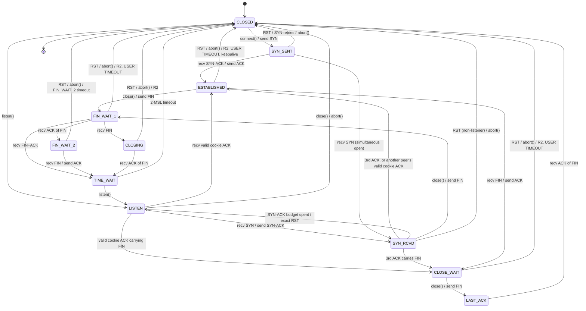

# Connection state machine

The eleven TCP states (RFC 9293 §3.3.2) and every transition this stack can
take. The graph is **implementation-accurate**: its edges are exactly the
relation of `State::debug_transition_allowed()` in
[`src/state.rs`](../src/state.rs). Every fuzz target panics if the live TCB
makes a move that relation does not allow, and a unit test in `src/state.rs`
fails if [`state-machine.dot`](state-machine.dot) draws a different set of
edges — so the picture, the oracle and the code cannot drift apart. The
transition sites are in [`src/tcb/`](../src/tcb/).

The diagram below is also committed as Graphviz
([`state-machine.dot`](state-machine.dot) →
[`state-machine.svg`](state-machine.svg)); the Mermaid copy renders inline on
GitHub with no build step.



Graphviz render (same graph, higher fidelity — dashed grey = abort edges,
bold purple = the SYN_RCVD → LISTEN revert, green = SYN-cookie promotion):


## Transitions

| From | To | Trigger | Action | Code |
| --- | --- | --- | --- | --- |
| CLOSED | SYN_SENT | `connect()` | send SYN | `Tcb::connect` |
| CLOSED | LISTEN | `listen()` (requires a secret) | — | `Tcb::listen` |
| LISTEN | SYN_RCVD | recv SYN | send SYN-ACK (stateful: keeps every option) | `on_listen` → `accept_syn_stateful` |
| LISTEN | ESTABLISHED | recv a valid cookie ACK | — | `on_listen` → `try_promote_via_cookie` |
| LISTEN | CLOSE_WAIT | valid cookie ACK carrying a FIN | send ACK | `promote_via_cookie` + `advance_state_on_remote_fin` |
| LISTEN | CLOSED | `close()` / `abort()` | — (local) | `Tcb::close` / `Tcb::abort` |
| SYN_SENT | ESTABLISHED | recv SYN-ACK | send ACK | `complete_active_open` |
| SYN_SENT | SYN_RCVD | recv SYN (simultaneous open) | send SYN-ACK | `simultaneous_open` |
| SYN_SENT | CLOSED | recv RST / SYN retries spent / `abort()` | surface `ConnectionReset` | `on_syn_sent` / `syn_sent_timer` |
| SYN_RCVD | ESTABLISHED | recv 3rd ACK — or, while the slot is busy, another peer's valid cookie ACK (it takes over the slot) | — | `complete_passive_open` / `on_busy_listener` |
| SYN_RCVD | CLOSE_WAIT | 3rd ACK carrying a FIN | send ACK | `complete_passive_open` + `advance_state_on_remote_fin` |
| SYN_RCVD | LISTEN | SYN-ACK retransmit budget exhausted, or exact-match RST | recycle the half-open slot | `syn_rcvd_timer` / `on_syn_rcvd` → `reset_to_listen_or_closed` |
| SYN_RCVD | FIN_WAIT_1 | `close()` | send FIN | `Tcb::close` |
| SYN_RCVD | CLOSED | recv RST (non-listener) / `abort()` | surface `ConnectionReset` | `on_syn_rcvd` |
| ESTABLISHED | FIN_WAIT_1 | `close()` | send FIN | `Tcb::close` |
| ESTABLISHED | CLOSE_WAIT | recv FIN | send ACK | `advance_state_on_remote_fin` |
| ESTABLISHED | CLOSED | recv RST / `abort()` / R2, USER TIMEOUT or keepalive | surface `ConnectionReset` | `on_reset_received` / `abort` / `tick` |
| FIN_WAIT_1 | FIN_WAIT_2 | recv ACK of our FIN | arm the FIN_WAIT_2 timeout | `process_ack` |
| FIN_WAIT_1 | CLOSING | recv FIN (simultaneous close) | send ACK | `advance_state_on_remote_fin` |
| FIN_WAIT_1 | TIME_WAIT | recv FIN+ACK in one segment | send ACK, arm 2·MSL | `process_ack` + `advance_state_on_remote_fin` |
| FIN_WAIT_2 | TIME_WAIT | recv FIN | send ACK, arm 2·MSL | `advance_state_on_remote_fin` |
| FIN_WAIT_2 | CLOSED | FIN_WAIT_2 timeout (restarted only by the application reading) | send RST | `tick` |
| CLOSING | TIME_WAIT | recv ACK of our FIN | arm 2·MSL | `process_ack` |
| TIME_WAIT | CLOSED | 2·MSL timeout (a retransmitted FIN restarts it, at most 120 s after entry) | free the slot | `tick` |
| TIME_WAIT | LISTEN | `listen()` | — | `Tcb::listen` |
| CLOSE_WAIT | LAST_ACK | `close()` | send FIN | `Tcb::close` |
| LAST_ACK | CLOSED | recv ACK of our FIN | free the slot | `process_ack` |

## Notable, non-textbook edges

- **SYN_RCVD → LISTEN** (bold purple). A listener keeps at most one half-open
  slot. Each SYN-ACK is retransmitted at most `MAX_SYN_RCVD_RETRIES` times;
  once that budget is spent — or an exact-match RST arrives (RFC 5961 §3.2; an
  inexact in-window RST draws a challenge ACK) — the slot is recycled straight
  back to LISTEN instead of leaking. This is why the loopback fuzzer withholds
  chaos until both ends are ESTABLISHED (a dropped third ACK that trips this
  revert is a legitimate half-open, not a deadlock).
- **Hybrid SYN cookies** (green). The free slot is always used statefully, so
  a client keeps window scaling and SACK even without timestamps. While the
  slot is busy, SYNs from other peers are answered with cookie SYN-ACKs (no
  state); a valid cookie ACK establishes directly from LISTEN, or from
  SYN_RCVD by taking over the pending half-open — a peer that proved it
  receives our packets beats one that has not, so spoofed SYNs cannot lock
  the listener. `listen()` requires a secret, and the cookie key is derived
  from it unless one is installed explicitly.
- **FIN_WAIT_1 → TIME_WAIT** (direct). When a single segment both ACKs our FIN
  and carries the peer's FIN, the two single-step edges collapse into one. The
  oracle's `allowed_transition` permits it explicitly.
- **Abort edges → CLOSED** (dashed grey). An exact-match RST (RFC 5961), a
  local `abort()`, or a timeout (R2, USER TIMEOUT, keepalive, FIN_WAIT_2)
  drops a synchronized state to CLOSED.

## Regenerating the SVG

After editing [`state-machine.dot`](state-machine.dot):

```sh
dot -Tsvg docs/state-machine.dot -o docs/state-machine.svg
```

Keep the `.dot` edges in lockstep with `State::debug_transition_allowed()` —
if you add a real transition, update both: the fuzzers reject a move the
relation does not allow, and `cargo test` fails while the diagram differs.
